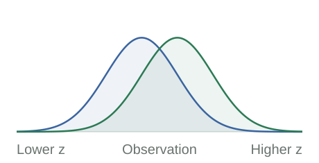
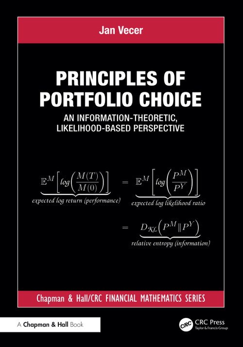
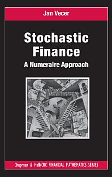

::: {.home-hero}
::: {.home-hero-copy}
[Jan Vecer / Research & ideas]{.eyebrow}

# Finance, read as **likelihood.** {.home-title .unlisted .unnumbered}

Prices, portfolio choice, and information share a mathematical language. Start with two probability measures. See how the rest follows.

::: {.hero-actions}
[Explore Likelihood Finance](likelihood/index.qmd){.action-link .action-primary}
[Start with one bet →](likelihood/index.qmd#one-claim){.action-link .action-quiet}
:::
:::

::: {.home-hero-visual}
[One price. Two probability measures.]{.diagram-eyebrow}

::: {.hero-equation}
$$
\frac{X(T)}{X(0)}
=\frac{d\mathbb P^X}{d\mathbb P^Y}.
$$
:::

{.hero-density-plot fig-alt="Two normal densities on the same state space: a market measure centered at zero and an asset measure centered at one. Their ratio is exp(z minus one half)."}

::: {.hero-legend}
[[]{.legend-dot .legend-market} Market measure $\mathbb P^Y$]{.legend-entry}
[[]{.legend-dot .legend-asset} Asset measure $\mathbb P^X$]{.legend-entry}
:::

[The ratio is evaluated at the observed state at time $T$. Here $X(t)$ is measured in units of $Y$, so $Y(t)=Y(0)=1$.]{.diagram-note}
:::
:::

::: {.home-principles}
::: {.home-principle}
[01 / Prices]{.eyebrow}

### A payoff is a probability model.

Weight market state prices by a normalized nonnegative payoff. The resulting distribution describes the states that the position emphasizes.
:::
::: {.home-principle}
[02 / Choice]{.eyebrow}

### A belief determines a portfolio.

The likelihood ratio of an investor's belief to the pricing measure gives the log-optimal payoff when the required claims are attainable.
:::
::: {.home-principle}
[03 / Information]{.eyebrow}

### Log performance is information.

Under an asset's own measure, its expected log performance is the relative entropy between that measure and the market measure.
:::
:::

::: {.home-section .home-information}
::: {.information-copy}
[A bridge to information theory]{.eyebrow}

## What does a likelihood ratio tell us? {.unlisted}

A ratio above one favors one probability model over another. Its logarithm measures the strength of that evidence. Average this log ratio under the first model, and you have **relative entropy**.

Because a normalized price is a likelihood ratio, the same number measures expected log performance. Here the expectation is under the asset measure $\mathbb P^X$.

[Understand relative entropy, one example at a time →](likelihood/relative-entropy.qmd){.text-link}
:::
::: {.information-equation}
$$
\begin{aligned}
&\mathbb E^X\!\left[\log\frac{X(T)}{X(0)}\right]\\[.35em]
&\quad=\mathbb E^X\!\left[\log\frac{d\mathbb P^X}{d\mathbb P^Y}\right]\\[.35em]
&\quad=D_{\mathrm{KL}}(\mathbb P^X\Vert\mathbb P^Y).
\end{aligned}
$$

**Two outcomes.** Probabilities $(0.6,0.4)$ versus $(0.5,0.5)$ give price multipliers $1.2$ and $0.8$. Their expected log performance is $0.0201$ nats.
:::
:::

::: {.home-section .explore-section}
::: {.section-intro}
[The interactive guide]{.eyebrow}

## One framework. Different points of entry. {.unlisted}

Read the essentials, move the probabilities, or follow a model from its distribution to its price process.
:::

::: {.entry-grid}
::: {.entry-item}
[01]{.entry-number}

### [The framework](likelihood/index.qmd)

State prices, likelihood ratios, log growth, and the distinction between a belief and an asset-implied measure.

[Build the framework, step by step →](likelihood/index.qmd){.text-link}
:::
::: {.entry-item}
[02]{.entry-number}

### [The models](likelihood/binomial.qmd)

Begin with two states. Continue through count distributions and continuous-time families with linear information flow.

[Open the binomial laboratory →](likelihood/binomial.qmd){.text-link}
:::
::: {.entry-item}
[03]{.entry-number}

### [Portfolio choice](likelihood/portfolio-lab.qmd)

Explore how preferences, attainable payoffs, and approximations change the distribution implemented by a portfolio.

[Experiment with portfolio choice →](likelihood/portfolio-lab.qmd){.text-link}
:::
:::
:::

::: {.home-section .books-section #books}
::: {.section-heading}

[The books]{.eyebrow}

## Two perspectives on the same market. {.unlisted}

:::

::: {.book-grid}
::: {.book-item}

::: {.book-copy}
[Forthcoming / Chapman & Hall–CRC]{.eyebrow}

### Principles of Portfolio Choice

[An Information-Theoretic, Likelihood-Based Perspective]{.book-subtitle}

A systematic development of the payoff–measure correspondence, linking portfolio selection to statistics and information theory.

[View the book at Routledge →](https://www.routledge.com/Principles-of-Portfolio-Choice-An-Information-Theoretic-Likelihood-Based-Perspective/Vecer/p/book/9781032951980){.text-link}
:::
:::

::: {.book-item}

::: {.book-copy}
[2011 / CRC Press]{.eyebrow}

### Stochastic Finance

[A Numeraire Approach]{.book-subtitle}

Derivative pricing and hedging viewed through relative prices, changes of numeraire, and the symmetry between assets.

[View the book at Routledge →](https://www.routledge.com/Stochastic-Finance-A-Numeraire-Approach/Vecer/p/book/9781439812501){.text-link}
:::
:::
:::
:::

::: {.home-section .research-section #papers}
::: {.section-intro}
[Selected research]{.eyebrow}

## From the framework to the literature. {.unlisted}

Published articles connected to the ideas on this site.

[More research & contact →](jan-vecer.qmd){.text-link}
:::

::: {.paper-list}
::: {.paper-item}
[2026 · Methodology and Computing in Applied Probability]{.paper-meta}

### [Likelihood-Ratio Pricing, Capital Lock-In, and Prefunded Restarts in Parimutuel Prediction Markets](https://rdcu.be/KDQhKRqs8mxa)

Jan Vecer
:::
::: {.paper-item}
[2026 · Quantitative Finance]{.paper-meta}

### [Analytical solution for Kelly's criterion for multiple outcomes](https://doi.org/10.1080/14697688.2026.2629952)

Jan Vecer
:::
::: {.paper-item}
[2025 · The European Journal of Finance]{.paper-meta}

### [Portfolio optimization beyond utility maximization: the case of driftless markets](https://doi.org/10.1080/1351847X.2024.2375221)

Jan Vecer, Mark Richard, and Stephen Taylor
:::
::: {.paper-item}
[2022 · European Journal of Operational Research]{.paper-meta}

### [On the utility maximization of the discrepancy between a perceived and market implied risk neutral distribution](https://www.sciencedirect.com/science/article/pii/S0377221722000856)

Robert Navratil, Stephen Taylor, and Jan Vecer
:::
:::
:::

::: {.home-closing}

[Start small. Keep the structure.]{.eyebrow}

## One bet is enough to begin. {.unlisted}

[Start with one bet →](likelihood/index.qmd#one-claim){.action-link .action-primary}
:::
