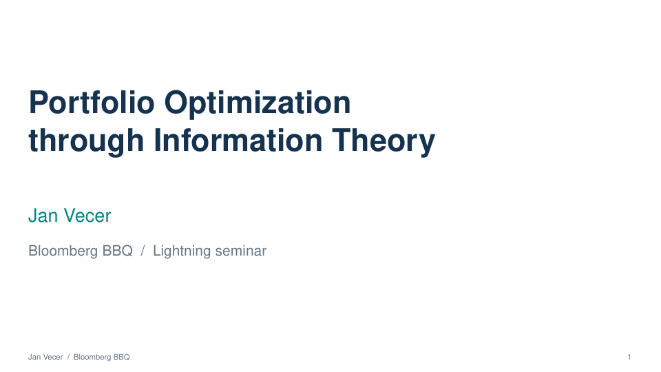
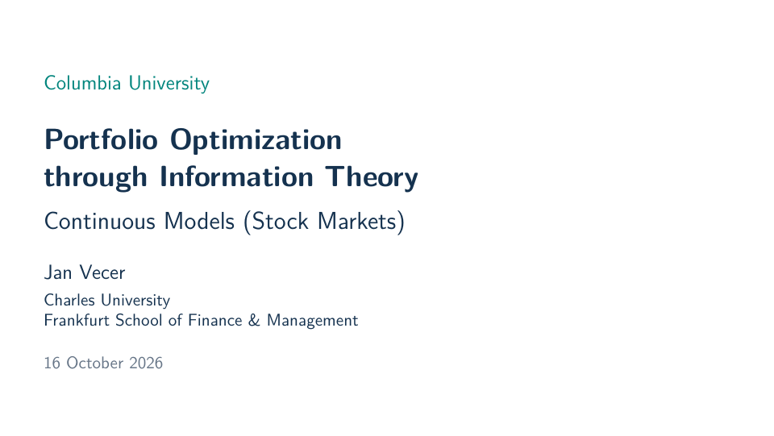
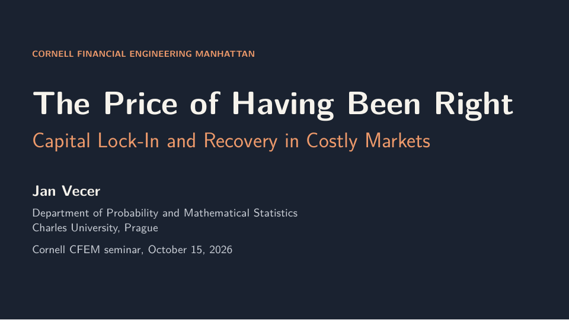
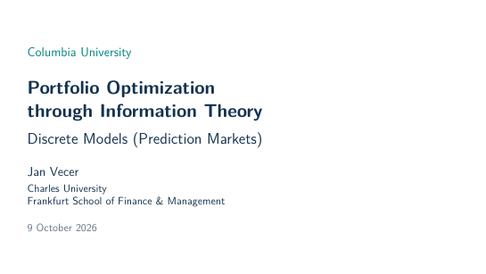
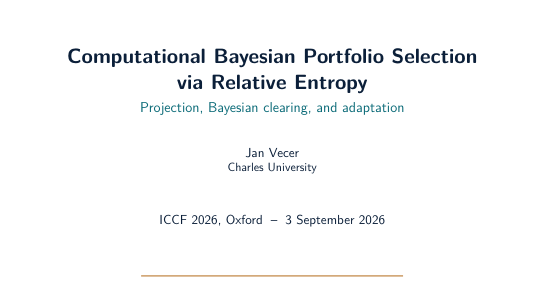

Explore **finance through information theory** through lectures, a research seminar, a lightning presentation, and the papers behind the ideas. The PDFs preserve the supplied originals; linked website pages develop the examples with interactive figures and additional explanations.

[Bloomberg](#bloomberg) · [Columbia: continuous models](#columbia-continuous) · [Cornell](#cornell) · [Columbia: discrete models](#columbia) · [Oxford](#oxford) · [Forthcoming paper](#forthcoming-paper)

::: {.resource-talk #bloomberg}

::: {.resource-copy}
[Bloomberg BBQ · 19 October 2026 · 9 pages]{.eyebrow}

## Portfolio Optimization through Information Theory {#bloomberg-title}

**Lightning seminar: information channels and option replication**

A short introduction to prices as information, from four analytical information flows to an S&P 500 channel decomposition. A worked example selects the observable normal-channel view and approximates the resulting target payoff by matching densities with cash, stock and options.

[Read the Bloomberg slides (PDF) →](assets/slides/bloomberg-bbq-information-theory-2026.pdf){.action-link .action-primary}

**Continue on the website:** [linear information flows](likelihood/linear-information.qmd), [options as distributions](likelihood/options.qmd), and [replication and approximation](likelihood/pricing-hedging.qmd).
:::
:::

::: {.resource-talk #columbia-continuous}

::: {.resource-copy}
[Columbia University · 16 October 2026 · 54 pages]{.eyebrow}

## Portfolio Optimization through Information Theory {#columbia-continuous-title}

**Continuous Models (Stock Markets)**

Connect likelihood ratios and portfolio choice to Merton's problem, quadratic hedging as regression, and four continuous-time linear information-flow models. Then use option-implied information channels to construct a target density and approximate its payoff with options.

[Read the Columbia continuous-model slides (PDF) →](assets/slides/columbia-continuous-information-theory-2026.pdf){.action-link .action-primary}

**Continue on the website:** [the model catalogue](likelihood/linear-information.qmd), [normal / GBM](likelihood/normal.qmd), [mean–variance and information](likelihood/mean-variance.qmd), and [options as distributions](likelihood/options.qmd).
:::
:::

::: {.resource-talk #cornell}

::: {.resource-copy}
[Cornell Financial Engineering Manhattan · 15 October 2026 · 66 pages]{.eyebrow}

## The Price of Having Been Right

**Capital Lock-In and Recovery in Costly Markets**

How successful forecasts can concentrate wealth and slow a prediction market's response to change. The talk studies the recovery limits created by trading fees and shows how shrinking baseline exposure combined with evidence-triggered increases can restore faster adaptation without new capital.

[Read the Cornell slides (PDF) →](assets/slides/cornell-capital-lock-in-recovery-2026.pdf){.action-link .action-primary}

**Continue on the website:** [Bayesian learning and commitment](likelihood/bayesian-learning.qmd) and [beliefs and attainable portfolios](likelihood/markets-portfolios.qmd).
:::
:::

::: {.resource-talk #columbia}

::: {.resource-copy}
[Columbia University · 9 October 2026 · 52 pages]{.eyebrow}

## Portfolio Optimization through Information Theory

**Discrete Models (Prediction Markets)**

Start with the price of a bet. Turn positive payoffs into probability distributions, derive log optimality, and see how replication and restricted trading determine attainable growth. A shared binomial and negative-binomial example compares exact KL, its local quadratic approximation, and quadratic hedging.

[Read the Columbia slides (PDF) →](assets/slides/columbia-information-theory-2026.pdf){.action-link .action-primary}

**Continue on the website:** [the framework](likelihood/index.qmd), [the binary example](likelihood/binomial.qmd), [the completed shock](likelihood/negative-binomial.qmd), and [three hedging criteria](likelihood/hedging-comparison.qmd).
:::
:::

::: {.resource-talk #oxford}

::: {.resource-copy}
[ICCF 2026, Oxford · 3 September 2026 · 22 pages]{.eyebrow}

## Computational Bayesian Portfolio Selection via Relative Entropy

**Projection, Bayesian clearing, and adaptation**

Connect portfolio selection and hedging to statistical optimization. Follow the relationship between relative wealth and Bayesian updating, then examine what changes when only part of wealth is committed and when capital is locked in.

[Read the Oxford slides (PDF) →](assets/slides/oxford-bayesian-portfolios-2026.pdf){.action-link .action-primary}

**Continue on the website:** [portfolio choice](likelihood/markets-portfolios.qmd), [the portfolio laboratory](likelihood/portfolio-lab.qmd), and [Bayesian learning and commitment](likelihood/bayesian-learning.qmd).
:::
:::

## Choose a reading route

| Your question | Start here | Then explore |
|:--|:--|:--|
| How can a price represent information? | [One bet](likelihood/index.qmd#one-claim) | [Relative entropy](likelihood/relative-entropy.qmd) |
| Which portfolio implements my beliefs? | [Beliefs and attainable portfolios](likelihood/markets-portfolios.qmd) | [Incomplete markets](likelihood/trinomial.qmd) |
| How do information and variance criteria differ? | [Three hedging criteria](likelihood/hedging-comparison.qmd) | [Mean–variance and information](likelihood/mean-variance.qmd) |
| How does information accumulate through time? | [Linear information flows](likelihood/linear-information.qmd) | [Columbia continuous-model lecture](#columbia-continuous) |
| How do information channels lead to option positions? | [Options as distributions](likelihood/options.qmd) | [Bloomberg presentation](#bloomberg) |
| How are wealth, learning and recovery connected? | [Bayesian learning and commitment](likelihood/bayesian-learning.qmd) | [Cornell](#cornell) and [Oxford](#oxford) presentations |
| What can an efficiency test measure? | [Forthcoming Quantitative Finance paper](research/relative-entropy-tests.qmd) | [Relative entropy](likelihood/relative-entropy.qmd) |

## Forthcoming in Quantitative Finance {#forthcoming-paper}

**Jan Vecer. Relative-entropy tests of market efficiency: symbolic benchmarks, finite alphabets, and attainable log-growth.** *Quantitative Finance*, forthcoming.

The paper connects symbolic efficiency tests with conditional relative entropy and likelihood-ratio inference. It distinguishes population information from statistical power under coarsening, relates information to attainable log growth, and includes a daily S&P 500 illustration.

[Paper overview →](research/relative-entropy-tests.qmd){.action-link .action-primary}

[Author manuscript (PDF)](assets/papers/relative-entropy-tests-market-efficiency-author-manuscript.pdf) · [Publisher DOI: 10.1080/14697688.2026.2749693](https://doi.org/10.1080/14697688.2026.2749693) · [BibTeX](assets/papers/relative-entropy-tests.bib)

The downloadable PDF is the author manuscript supplied here. The DOI identifies the forthcoming journal article.

## Books and research

The systematic development appears in *Principles of Portfolio Choice: An Information-Theoretic, Likelihood-Based Perspective*. The earlier *Stochastic Finance: A Numeraire Approach* develops the relative-price and numeraire foundations.

[Books](index.qmd#books) · [Selected papers](index.qmd#papers) · [About Jan Vecer and contact](jan-vecer.qmd)

The slide decks are archived presentations. Dates, affiliations, and announcements inside them reflect the original talks.
